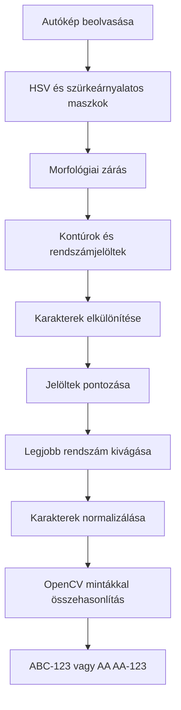

# Magyar rendszámfelismerő – C++ és OpenCV

Tanulási célú rendszámfelismerő program, amely **szemből fényképezett, fehér hátterű magyar rendszámokat** keres, kivágja a karaktereket, és saját, OpenCV-vel létrehozott minták alapján megpróbálja kiolvasni a rendszámot.

**Támogatott alakok (a projektben):** `ABC-123` és `AA AA-123`. A program nem használ Tesseractot, külön OCR-szolgáltatást vagy betanított neurális hálót.

> **Állapot:** oktatási prototípus. Hat megadott képen korábbi OpenCV-s prototípussal a várt feliratokat kaptuk, de a csomagolt C++ változat Visual Studióban történő fordítását és futását a felhasználó gépén még külön ellenőrizni kell. Nem minden fényképen garantált a helyes felismerés.

## Mit mutat meg?

- Világos régiók keresése HSV és szürkeárnyalatos küszöböléssel
- Morfológiai zárás és kontúrkeresés
- Jelöltek rangsorolása: arány, elhelyezkedés, világos háttér, karakterszám és egyenletesség
- EU-kék sáv és a rendszámkeret/alsó reklámsáv figyelmen kívül hagyása
- Karakterek szegmentálása `connectedComponentsWithStats()` segítségével
- Karakterek balról jobbra rendezése, méretnormalizálása és sablon-összehasonlítása (`bitwise_xor`)
- Régi és új magyar formátum összeállítása, eredmény kirajzolása és mentése

## Gyors indítás Visual Studióban

1. Legyen működő **Visual Studio C++ + OpenCV 4.x** projekted, `x64` célplatformmal. Ez a projekt **nem telepíti az OpenCV-t**, azt a környezetedben be kell állítani.
2. Másold a `src/Rendszamfelismero.cpp` tartalmát a projekted `.cpp` fájljába, vagy add hozzá új forrásfájlként. Egy projekten belül **csak egy `main()`** függvény maradjon.
3. A hat tesztképet – ha jogszerűen használhatod őket – tedd a projekted munkakönyvtárához viszonyított `kepek` mappába, az alábbi nevekkel: `auto2.jpg`, `auto4.jpg`, `auto5.jpg`, `auto9.jpg`, `auto10.jfif`, `auto11.jpg`.
4. Ha a képeid más mappában vannak, a Visual Studio **Project → Properties → Debugging → Command Arguments** mezőjébe írd a képmappa teljes útvonalát, például `"C:\Kepek\Rendszamok"`. A **Working Directory** legyen a projekted mappája, ha az alapértelmezett `kepek` almappát használod.
5. Indítás: **Ctrl + F5**. A program képenként vár egy billentyűleütést; `Esc` megállítja a bemutatót.

A futtatáskor két ablak jelenik meg: `Rendszam helye` és `Karakterek`. Az eredményképeket ugyanabba a képmappába menti `eredmeny_auto2.png` stb. néven.

**Tipp:** ha „Nem sikerult megnyitni!” üzenetet látsz, ellenőrizd az aktuális munkakönyvtárat, a fájlneveket és a parancssori argumentumot. A kód már **nem tartalmaz személyes Windows-elérési utat**.

## Fordítás CMake segítségével (opcionális)

A repó tartalmaz `CMakeLists.txt` fájlt. Ha az OpenCV fejlesztői csomagja elérhető a CMake számára:

```powershell
cmake -S . -B build -DOpenCV_DIR="C:/opencv/build"
cmake --build build --config Release
```

Az `OpenCV_DIR` pontos elérési útja telepítésenként eltér, és olyan mappára kell mutatnia, ahol `OpenCVConfig.cmake` található. A programot a buildelt `.exe` helyéről is indíthatod, a képmappa útját argumentumként átadva.

## Működési folyamat



> **Miért nincs Canny a végleges kódban?** A fejlesztés elején kipróbáltuk, de a hűtőrács és a lökhárító élei sok hamis jelöltet adtak. A végső prototípus az egész képen világos területeket keres, majd a lehetséges karakterek alapján pontoz.

## Tesztadatok és korlátok

A hat kép elvárt felirata és a teszt részletei a [`docs/teszteles.md`](docs/teszteles.md) fájlban találhatók. A képfájlokat **nem csomagoltuk a GitHubra kész repóba**, mert a közösségi oldalakról vagy más webhelyekről származó fotók újraközlésének joga nem feltétlenül adott. Csak saját vagy megfelelő licencű képeket tölts fel nyilvánosan.

**Ismert korlátok:** ferde/perspektivikusan torzult rendszámok; eltérő fényviszonyok; árnyék, becsillanás, takarás; motorkerékpár-rendszámok; különleges betűtípusok; más országok vagy más formátumok. A sablonillesztés nem neurális háló, ezért bizonytalan karaktereknél tévedhet.

## Dokumentáció

- [Órai előadás – felolvasható szöveg](docs/orai_eloadas.md)
- [Részletes műszaki magyarázat](docs/muszaki_leiras.md)
- [Telepítés és bemutató](docs/telepites_es_bemutato.md)
- [Tesztelés és eredmények](docs/teszteles.md)
- [Tanári kérdések – rövid válaszok](docs/gyakori_kerdesek.md)
- [Közreműködés és továbbfejlesztés](CONTRIBUTING.md)
- [Változások](CHANGELOG.md)

## Felhasználás és képek

A repóhoz jelenleg **nincs választott szoftverlicenc**. Ha nyilvános, mások által újrafelhasználható projektet szeretnél, előbb válassz megfelelő licencet GitHubon, és add hozzá a `LICENSE` fájlt. A külső tesztképek jogait külön kell kezelni. Lásd: [`docs/licenc_es_kepek.md`](docs/licenc_es_kepek.md).
